 

 

 

 

 

 

 

 

I'm always interested in collaborating on challenging engineering problems, AI-powered products, open-source projects, and innovative ideas.

<b>"The best way to predict the future is to build it."</b>

